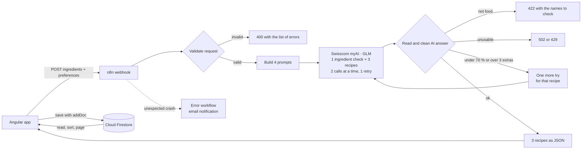

# Code à Cuisine

**Tell it what is in your fridge. Get three recipes you can cook right now.**

Code à Cuisine is an AI recipe generator built with Angular 21, Firebase and an n8n workflow. You enter the ingredients you have at home, choose servings, cooking time, cuisine, diet and how many people cook together, and the app creates three different recipes with step-by-step directions, a fair split of the work between the cooks and nutrition facts per serving. Every generated recipe is saved to a public cookbook that anyone can browse, sort and like.

I built it as the final project of my training as a frontend developer at the Developer Akademie.

**Live demo:** [codeacuisne.andreas-kissner.cloud](https://codeacuisne.andreas-kissner.cloud)

[](https://github.com/AndreasKissner/codeacuisine/actions/workflows/ci.yml)

<!-- Add 2 or 3 screenshots or a short GIF here: start page, results, recipe detail on mobile.
 -->

---

## Highlights

- **AI from Swisscom.** The recipes are written by the language model of Swisscom myAI. The key stays in n8n and never reaches the browser.
- **Three really different recipes per request.** Three AI calls run in parallel, each with its own angle (a classic pan dish, a different dish type, a creative idea), so the suggestions do not repeat each other.
- **Ingredients are checked before any recipe is written.** A fourth, deterministic AI call flags input that is not food (keyboard mashing, objects), and the user gets a clear message instead of a made-up recipe.
- **A diet check in the browser.** With Vegetarian or Vegan selected, ingredients like tuna or milk are caught from word lists (German and English, loaded only when needed) and the user can continue without them.
- **Cooking together.** For two to four cooks, every step is assigned to a chef, and the work is shared fairly.
- **A public cookbook.** Most liked and newest recipes, one list per cuisine with sorting and paging, and hearts that are counted in Firestore.
- **Validated three times.** In the form, again in the n8n workflow and a third time in the Firestore security rules. Nothing unchecked reaches the database.
- **Accessible and mobile first.** Semantic HTML, a skip link, keyboard support, visible focus, screen reader labels and announcements, a title for every page, minimum font size of 16 px and colour contrast following WCAG 2.1 AA. Motion is reduced when the system asks for it.
- **Easy on the database.** Recipes that are already in memory are never loaded again, lists load 12 recipes at a time, and pages that were visited before come from memory.
- **Fast.** Photos are WebP, the loading animation is a 0.2 MB video instead of a 4 MB GIF, the larger pages are loaded on demand, and the server compresses and caches the files.
- **An easter egg.** Look for the seventh cuisine in the cookbook.

## How it works



1. **Angular** collects ingredients and preferences in typed reactive forms and checks them right away (amounts per unit, plausible ingredient names, 3 to 10 ingredients).
2. **n8n** validates the request again, because anyone could call the webhook directly. It builds four prompts and calls the AI model. The AI key exists only in n8n, never in the frontend.
3. The workflow **never forwards raw AI output**. It removes HTML and control characters, shortens texts, rounds numbers, enforces the allowed units and limits each amount to what the user actually has. It also checks that every recipe uses at least 70 % of the ingredients that fit the diet and adds at most 3 extras. A recipe that breaks this gets one more try with the reason.
4. **Angular saves** the three recipes to Firestore. The security rules accept only documents with exactly the expected fields, types and lengths.
5. The **cookbook** reads from Firestore with small, indexed queries.

## Tech stack

| Area | Technology |
| --- | --- |
| Frontend | Angular 21 (standalone components, signals, `input()`, `computed()`, `effect()`, new control flow), TypeScript in strict mode |
| Forms | Reactive Forms with strict typing and custom validators |
| Styling | SCSS with an abstracts and base structure, BEM, mixins, mobile first |
| Database | Cloud Firestore (Firebase JS SDK) with security rules and composite indexes |
| Automation | n8n (self-hosted with Docker behind nginx) |
| AI | Swisscom myAI, model `glm-5.3-flash`, called only from n8n |
| Hosting | Apache (IONOS) with an `.htaccess` for the single page app routing |

## Engineering decisions

- **Signals only, no RxJS in the app code.** State lives in small services with signals, components derive everything else with `computed()`.
- **No `ngOnInit`, small functions.** Initialisation happens in the constructor or in `effect()`, functions stay below 16 lines and do one thing, public methods have JSDoc.
- **Defence in depth.** The browser checks for a good user experience, n8n checks because the webhook is public, and the Firestore rules check because the database is public.
- **Optimistic hearts with exact rollback.** A heart counts at once, is saved with Firestore `increment()`, and if the rules reject it, the previous state is restored exactly.
- **Paging with cursors instead of offsets.** Firestore bills every document it reads, so the list pages with `startAfter()` and keeps visited pages in memory.
- **Lazy loading.** The recipe detail page and the cookbook are loaded on demand, which keeps the first download small.
- **Saving without duplicates.** The three recipes are saved one by one. If one fails, Try again saves only the missing one.
- **Prompt injection.** Ingredient names are passed to the model as data with the explicit rule never to follow instructions inside them, and the answer is validated against a fixed shape.

## Security

- The AI key and the n8n credentials never reach the browser. The Firebase web config is public by design and protected by the security rules.
- **Firestore rules:** reading single recipes is public, lists are limited to 12 documents per query, new recipes must match the exact schema with `likes == 0` and the server timestamp, updates may only change `likes` by one, deleting is not allowed, every other path is closed. The hearts of the seven fixed film recipes live in their own collection `filmLikes`, which accepts only those seven ids.
- **n8n:** request validation, output cleaning, a timeout and one retry for the AI call, rate limit errors passed on as 429, and an error workflow that sends an email when something crashes unexpectedly.
- **Server (`.htaccess`):** HTTPS redirect, security headers (`X-Content-Type-Options`, `Referrer-Policy`, `X-Frame-Options`, `Permissions-Policy`, HSTS) and compression.
- `src/environments/environment.ts` is ignored by git. The repository contains only an example with placeholders, and the exported n8n workflows contain no credentials.

## Getting started

### Requirements

- Node.js 20.19, 22.12 or 24 and npm
- A Firebase project with Cloud Firestore
- An n8n instance and an API key for an OpenAI compatible chat completions endpoint (the project uses Swisscom myAI)

### 1. Install

```bash
git clone https://github.com/AndreasKissner/codeacuisine.git
cd codeacuisine
npm install
```

### 2. Configure the environment

```bash
cp src/environments/environment.example.ts src/environments/environment.ts
```

Fill in the Firebase web config from the Firebase console (Project settings, Your apps) and the URL of your n8n webhook.

### 3. Set up Firestore

1. Create a Firestore database.
2. Publish the rules from [`firestore.rules`](firestore.rules).
3. Create the two composite indexes on the `recipes` collection from [`firestore.indexes.json`](firestore.indexes.json): `cuisine` ascending with `likes` and `createdAt` descending, and `cuisine` ascending with `createdAt` descending. Firestore also shows a direct link when a query needs an index.

### 4. Import the n8n workflows

1. In n8n, import [`n8n/code-a-cuisine-workflow.json`](n8n/code-a-cuisine-workflow.json) and [`n8n/code-a-cuisine-error-handler.json`](n8n/code-a-cuisine-error-handler.json).
2. In the node **Call AI**, create a Header Auth credential with `Authorization: Bearer <your key>`.
3. In the error handler, choose an SMTP credential and set the sender and the recipient.
4. In the settings of the main workflow, select the error handler as **Error workflow** and activate the main workflow.

### 5. Run

```bash
npm start
```

The app opens at `http://localhost:4200`.

## Scripts

| Command | What it does |
| --- | --- |
| `npm start` | Development server with live reload |
| `npm run build` | Production build for a domain root, includes the `.htaccess` |
| `npm run build:server` | Production build for the subfolder `/angular-projects/codeacuisine/` with source maps |
| `npm test` | Unit tests with Vitest |

## Testing

Unit tests with Vitest cover the ingredient name check, the diet check (including everyday plant foods that must never be flagged), the amount rules, the recipe tags, the data of the film recipes and the saving logic of the generator, including the case where only some recipes could be saved. GitHub Actions builds the app and runs the tests on every push to `main`.

The user flows were tested by hand in the browser at 320, 375, 768 and 1440 px.

## Deployment

The build is written to `dist/codeacuisine/browser/`. For a domain root, upload everything including the `.htaccess`. It sends unknown paths to `index.html` so that reloading a page like `/recipes/<id>` works, redirects to HTTPS, compresses the files and sets security and cache headers. For a subfolder, use `npm run build:server` and leave out the `.htaccess`.

## Project structure

```text
src/
├── app/
│   ├── landingpage/       start page
│   ├── not-found/         page for unknown addresses
│   ├── generate-recipe/   ingredient form and list, validators
│   ├── preferences/       servings, cooks, time, cuisine, diet, diet check
│   ├── generating/        loading and error states
│   ├── recipes/           the three results
│   ├── recipe-detail/     recipe page with directions and hearts
│   ├── library/           cookbook start page
│   ├── library-list/      recipes of one cuisine with sorting and paging
│   ├── recipe/            models, Firestore store, generator service, guards
│   └── shared/            header, button, chips, stepper, popup, info tip
├── environments/          environment.example.ts (environment.ts is ignored)
└── styles/
    ├── abstracts/         colors, typography, variables, mixins
    └── base/              reset and global styles
n8n/                       exported workflows without credentials
firestore.rules            Firestore security rules
firestore.indexes.json     composite indexes for the cuisine lists
docs/                      error handling overview
```

More details on every error case: [`docs/errorhandling.md`](docs/errorhandling.md).

## Roadmap

- Daily quota per IP address and for the whole system in n8n (3 per IP, 12 per day)
- A second diet check in the n8n workflow, so that the rule also holds for direct calls
- Firebase App Check against direct database calls

## About me

I am Andreas Kissner, a frontend developer from <!-- city -->. I enjoy turning designs into fast, accessible interfaces and building the small automations behind them.

<!-- [LinkedIn](https://www.linkedin.com/in/...) · [Portfolio](https://...) -->

Design: Developer Akademie.
